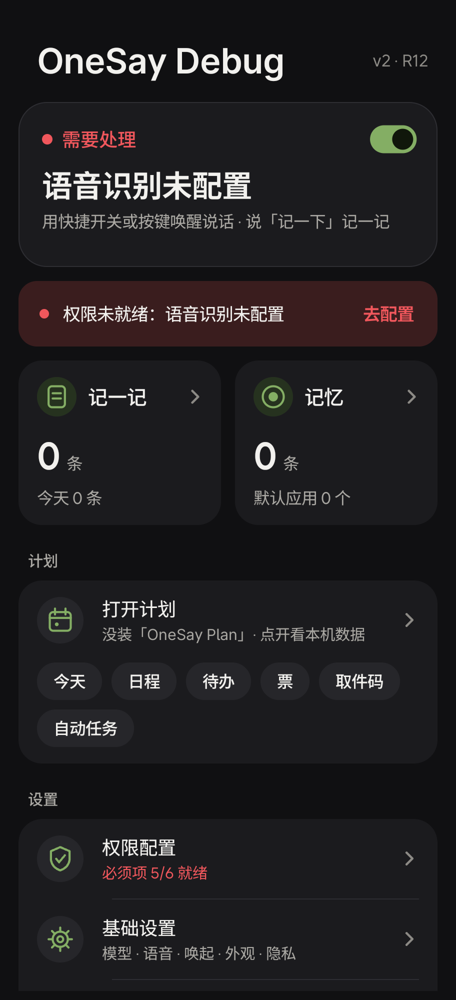
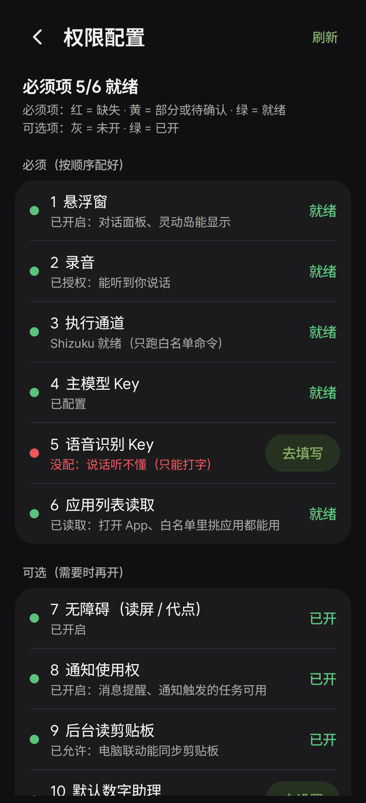
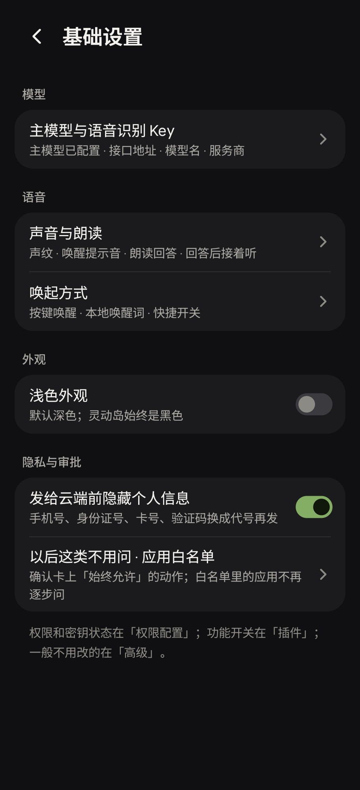
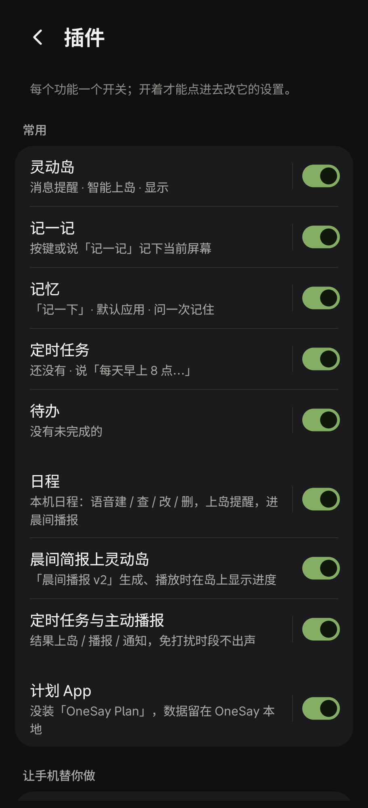
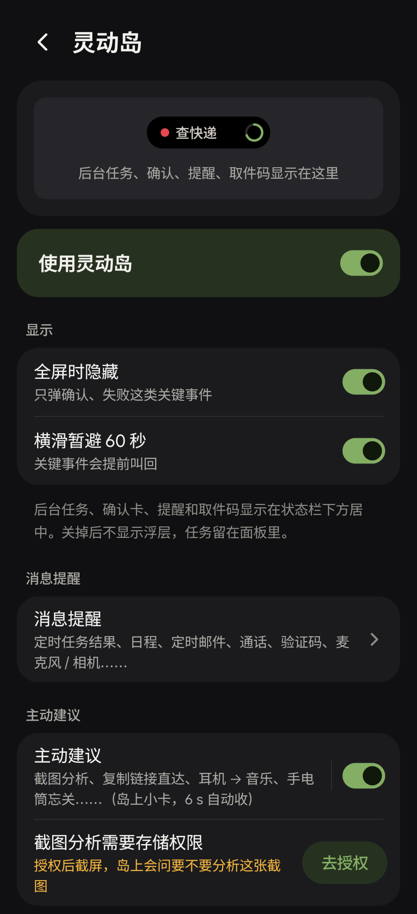
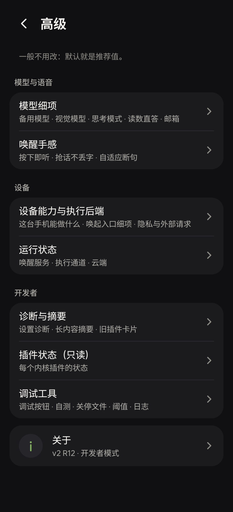
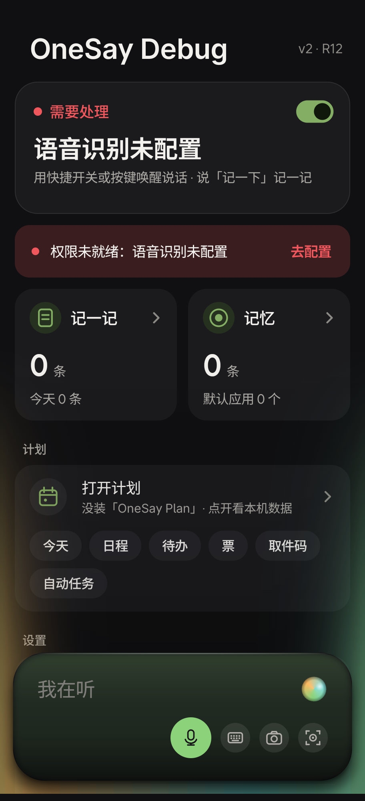
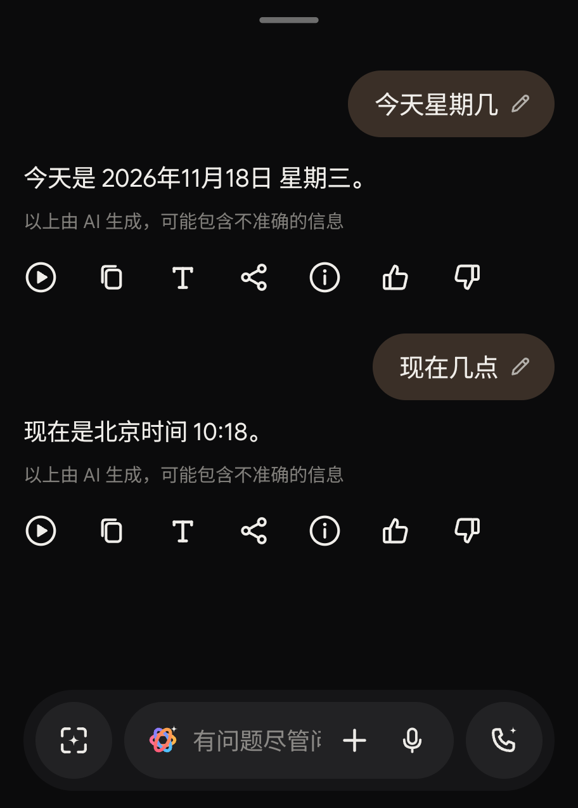

# OneSay

**一句话使唤你的手机，连电脑也能隔空指挥。** 自己配大模型，数据留在本机。

OneSay 是一套开源的中文语音助手：

| 部分 | 做什么 |
|---|---|
| **OneSay 助手**（Android） | 打开就是对话框：说一句话或打一行字，它去做：开关设置、打开 App、查信息、记事、替你点屏幕跑完多步任务。可以设成系统默认数字助理。也是插件宿主。 |
| **OneSay 计划**（Android） | 存「帮你记下来的东西」：待办、日程、票、取件码、快捷指令。 |
| **OneSay 时钟**（Android） | 闹钟 + 晨间语音简报（报时、天气、降雨提醒）。 |
| **OneSay 电脑端**（Windows） | 和手机配对后互相下指令：手机让电脑开网页、跑快捷指令、下载链接；电脑让手机响铃找手机、亮屏、发剪贴板。按住空格说话，侧栏看手机上的计划。 |

三个手机 App 单独装也能用；装在一起时，助手把待办写进计划、把闹钟交给时钟。

> **目前不提供安装包。** 手机端和电脑端都还没有在 Releases 里发布安装包，想用的话需要自己从源码编译，方法见下文「[从源码构建](#从源码构建)」。

---

## 手机首页：对话控制台

打开 OneSay 助手，首页就是一个对话框，不用先进设置：

- **顶上一排小标签**显示助手现在的真实状态。黄色、红色的标签能点，点了直接去处理（比如还没填语音识别 Key）。
- **「可以这样说」**给四句例句，点一下就当你说了这句话发出去。
- **「今天」**只放真实数据（日程、待办、取件码这类），全都没有时这块不显示。
- **底部**是「＋」、输入框和蓝色麦克风：点一下麦克风开始说，或按住说、说完松手；输入框里有字时麦克风换成纸飞机，点了发送。
- 你说的话是蓝色气泡，回答是灰色气泡；要你确认的事情和执行结果画成带颜色的卡片（确认的规则和以前一样）。
- 说话时会进全屏聆听：圆球跟着音量动，边说边出字，可以重说、停止或改成打字，说完回到同一段对话。
- 左上「☰」只显示这一次的对话（App 不保存聊天记录）；右上「⚙」是原来的设置首页，分组不变。
- 不习惯的话，可以在「设置 › 高级」里关掉「对话控制台」，换回原来的卡片样式。

## 设为系统默认数字助理

OneSay 助手可以设成手机的默认数字助理，这样不打开 App 也能叫它：

- 设置方法：「设置 › 高级 › 设备 › 设为默认助理」，这一行会显示现在是不是默认。点了会按顺序试：直接弹系统的确认框 → 系统的「助理和语音输入」设置页 → 「默认应用」页 → 应用信息页，在系统页面里选 OneSay 就行。「权限配置」里的可选项「默认数字助理」也能直达。
- 设好以后，可以用**长按电源键 / 长按 Home 键**、**从屏幕下方角落往上滑**（手势导航时）、或在锁屏上召唤，弹出来的就是平时的唤醒卡片，只弹一次。
- **注意：**部分厂商系统（比如 Flyme）的长按电源键不交给第三方助理，设了默认也叫不出 OneSay。这种手机请用**角落上滑**，或者用快捷开关、桌面小部件、语音唤醒词。

---

## 安装

### Windows 电脑端 0.5.1　`测试中`

电脑端源码在 `apps/desktop`，当前版本 0.5.1。**目前不提供安装包**，需要自己从源码打包（见下文「从源码构建」），打出来的就是 `OneSay-Setup-0.5.1-x64.exe`。以后在 Releases 发布时会附同名的 `.sha256` 文件。下面是安装包的安装说明：

1. **核对文件没被改过**（推荐）。拿到 `OneSay-Setup-<版本>-x64.exe` 后，在它所在的目录打开 PowerShell：
   ```powershell
   Get-FileHash .\OneSay-Setup-<版本>-x64.exe -Algorithm SHA256
   ```
   或者用 `certutil -hashfile OneSay-Setup-<版本>-x64.exe SHA256`。
   算出来的值要和 `.sha256` 文件里那一串**完全一样**，不一样就别运行。
2. **安装包没有代码签名**，所以 Windows SmartScreen 会提示「Windows 已保护你的电脑 / 未知发布者」。点 **更多信息 → 仍要运行**。这个提示是因为没签名，不说明文件有问题。请先做第 1 步核对。
3. 安装时**不要管理员权限**，也不会弹 UAC，默认装到 `%LOCALAPPDATA%\Programs\OneSay`，只写当前用户的注册表。可选「桌面快捷方式」（默认勾）和「开机自动启动」（默认不勾）。
4. **第一次启动时 Windows 防火墙会弹窗**，问是否允许 OneSay 通信。勾选 **「专用网络」** 后点「允许」；公用网络不用勾。不允许的话，手机在局域网里连不上电脑。
5. 支持 64 位 Windows（x64 / ARM64）。安装包自带精简版 Java 运行时，不用另装 Java。

卸载：「设置 › 应用」里卸载 OneSay。「同时删除我的数据」默认不勾，勾上后还会再问一次。
升级：直接运行新版安装包，装回原来的目录，原来的设置保留。

### Android 手机端

- 需要 Android 7.0 及以上（时钟支持 Android 6.0 起）。
- **目前不提供安装包，需要自己编译**（见下文「从源码构建」）。三个 App 之间的通道只认同一把签名，所以三个都要用**你自己的同一把密钥**签名（签名不一致时，后装的那个会安装失败）。
- 第一次打开后，在手机上手动打开这些权限：麦克风、悬浮窗、相机（扫码配对用）、存储；如果要稳定在后台唤醒，再把助手加进电池优化白名单。
- 必填：**主模型 Key**（默认 DeepSeek，也可以换成任何 OpenAI 兼容服务）和**语音识别 / 朗读 Key**（阿里云百炼）。OneSay 不内置任何 Key。

### 手机和电脑互联（配对）　`测试中`

手机和电脑配对以后可以互相下指令：手机让电脑开网页、跑快捷指令、下载链接；电脑让手机响铃找手机、亮屏、调音量、写剪贴板、弹通知。

**扫码配对：**

1. 电脑和手机连同一个 Wi-Fi（同一个路由器）。
2. 电脑端主页最上面有「连接手机」卡，点「配对」出二维码（「设置 › 连接 › 配对手机」里也有）。
3. 手机打开 OneSay 助手「设置 › 连接 › 电脑联动」，点「扫码配对」扫这个二维码（需要相机权限）。
4. 电脑端显示这台手机「在线」就好了。之后手机说「让电脑打开 xx 网页」、电脑上点「找手机」都可以用。

**不扫码也行：**在手机的「电脑联动」页让它找同一网络里的电脑，电脑上点「允许」，再核对两边显示的 4 位码一样就配好了。

说明：

- 二维码 / 配对串**等于钥匙**，不要截图发到群里。担心泄露时在电脑端点「换一把钥匙」，旧码立刻作废，再重新扫码。
- 同一个 Wi-Fi 下直接连：双向 TLS，两端各用自签证书，按证书指纹互认，电脑监听 TCP 47820，用 UDP 47821 应答已配对设备的发现。没配对的设备扫不到这台电脑。
- 连不上时先看 **Windows 防火墙**：第一次启动的弹窗要勾「专用网络」。如果当时点了取消，到「Windows 安全中心 › 防火墙和网络保护 › 允许应用通过防火墙」里给 OneSay 勾上「专用」。另外确认电脑当前网络的类型是「专用」，不是「公用」。
- 不在同一个网络时可以配中转（可选，需要自建），见 `apps/desktop/docs/PCLINK.md`。

---

## 安全：能批就不拦

原则：**除了三条硬规则，其余敏感动作都先问你；你批了就做，不会一律拒绝。**

### 三条硬规则（你批了也不行，根本不会弹确认）

1. **付款 / 转账的最后一下必须你亲手点。** 机器人可以帮你走到收银台，遇到「确认支付 / 立即付款 / 确认转账」这类按钮就停下；远程发来的付款类指令一律拒绝。
2. **机器人和远程指令不能改 OneSay 自己的权限，也不能自己批准。** 改档位、改信任列表、改「以后这类不用问」清单、远程卸载或停用 OneSay，都会被拒。给其他 App 授权的命令只生成脚本，由你自己执行。
3. **电脑不提权。** OneSay 启动的程序永远不以管理员身份运行，也不弹 UAC；需要管理员权限的操作只生成一份 `.ps1` 脚本，写明为什么需要管理员，由你自己决定要不要运行。

### 怎么问你

- **确认卡**：电脑右下角或手机屏幕上弹出，写明要做什么、为什么要问。60 秒不点 = 拒绝。
- **只认真人手指**：手机确认卡被别的窗口挡住、被无障碍服务代点、或刚被机器人点过屏幕时，点击都不算；默认焦点在「拒绝」。
- **语音和远程都不能批准**：卡片在等时对手机说「好的 / 允许」，它只会提醒你在屏幕上点。电脑上的确认可以在已配对手机的确认卡上批。
- **「以后这类不用问」**：确认卡上勾选后，同一类动作以后直接做。在「设置 › 权限与审批 › 以后这类不用问」里能看到全部，每一条都能撤销。
- **读过外部文字后，发送必须确认**：一次任务里只要读过网页、短信、邮件或通知，后面任何「发送 / 分享 / 提交」都会弹卡，就算你以前点过「始终允许」也一样。这是为了防止网页里藏的指令让助手替你乱发消息。`测试中`
- **发给云端前先脱敏**：手机号、身份证号、银行卡号、邮箱、验证码在本机换成 `[手机号#1]` 这类代号再发给大模型；需要往输入框里填时，在本机换回真实内容。「设置 › 模型与密钥」里可以关，默认开。`测试中`

### 电脑端的两个开关（沙箱档 × 审批策略）

| 沙箱档 | 能做什么 |
|---|---|
| 只读 | 只查状态，其他都不做 |
| **工作区可写**（默认） | 自由读写工作区 `%USERPROFILE%\OneSay\workspace`；执行命令、跑工作区脚本、写工作区以外的文件，先问你，批了就按你的用户权限执行 |
| 完全访问 | 按你的用户权限操作整台电脑（仍受三条硬规则约束） |

| 审批策略 | 什么时候问 |
|---|---|
| **分类**（默认） | 按动作类别，敏感的先问 |
| 按需 | 超出沙箱时才问 |
| 从不 | 一次都不问，沙箱外的直接拒绝 |

另外有一个默认开的**安全插件**：工作区里的 `.git` 等目录只读；只读档和工作区可写档下命令默认不联网，只有加进「命令可以联网的域名」的才行；拦截 `-enc`、`iex` 这类看不出真实意图的编码命令（这一项可以单独关）。三条硬规则关不掉。

### 接口优先

助手做一件事时，按这个顺序选路：**系统接口**（闹钟、计时、日历、联系人、设置页）→ **你配置过的服务接口**（天气、搜索等，没填 Key 就跳过；开源版默认关）→ **App 深链**（打不开就用浏览器打开对应网页）→ 最后才**替你点屏幕**。订票、外卖、下单只帮你打开到下单页，付款留给你。执行过程在回答上方的时间轴里能逐步展开查看，随时可以按停止键中断。部分 App 深链还没在真机上验证。`测试中`

---

## 链接下载　`测试中`

手机分享一个视频链接给 OneSay（分享菜单「下到电脑」，或者说「用电脑下载这个视频」），电脑下载完，通知栏显示进度。

- **下载工具按需安装、校验后才用**：安装包里不带下载工具。你在「设置 › 下载」点「安装」时，才从官方发布页下载 yt-dlp 和 FFmpeg，和官方公布的 SHA-256 对上才放到位；以后每次运行前再校验一遍，不对就不运行。
- **FFmpeg 只用 LGPL 构建，不随安装包分发。** 发布页上找不到 LGPL 构建时不会自动安装。
- **登录内容只用你自己导出的 `cookies.txt`**（Netscape 格式），只保留对应网站那几行，只有当前 Windows 账户能读；下载时用临时副本，用完就删。OneSay 不读浏览器 Cookie，也不装浏览器扩展。
- **链接检查**：只收 http / https；链接里正常的 `&`、`=`、`%` 查询参数都保留（比如 `?v=xxx&t=10`）；空格、`; | $ < > " ' \ { } ^`、反引号、以 `-` 开头、带账号密码的链接都拒绝。链接作为单独一个参数交给下载工具，不经过命令行解释。会自动去掉 `utm_*`、`spm`、`fbclid` 这类跟踪参数。
- **只下载你有权下载的内容。** OneSay 不破解 DRM，也不绕过网站的付费或权限限制。
- 下好的文件在 `%USERPROFILE%\OneSay\Downloads`。5 MB 以内的可以传回手机，更大的只告诉你电脑上的路径。

---

## 界面一览

| 控制台首页 | 权限配置 | 基础设置 | 插件 |
|---|---|---|---|
|  |  |  |  |
| **插件设置（灵动岛）** | **高级** | **唤起面板** | **对话** |
|  |  |  |  |

截图来自 debug 包（Android 16 · 无 root，执行通道走 Shizuku），状态栏已裁掉。这组截图是对话控制台上线前拍的：第一张「控制台首页」现在是首页右上「⚙」打开的设置首页，新的对话首页还没补截图。

## 设置在哪里

手机首页是对话控制台（见上文）；右上「⚙」打开的设置首页只回答三件事：**助手好不好用**（顶部状态卡 + 至多一条提醒）、**你要的东西**（记一记 · 记忆 · 计划）、**去哪改**（4 行设置）。

| 设置 | 里面有什么 |
|---|---|
| **权限配置** | 按步骤排好的必须项（悬浮窗 · 录音 · 执行通道 · 主模型 Key · 语音识别 Key · 应用列表读取）和可选项（无障碍 · 通知使用权 · 后台读剪贴板 · 默认数字助理…）。红 = 缺、黄 = 部分或待确认、绿 = 就绪，每行右边一个直达按钮。首页提醒条点「去配置」就到这里。执行通道有 root 守护或 Shizuku 任一就绪即可；都没有时是黄色「待配置」，不影响问答。 |
| **基础设置** | 不随插件开关变化的常用项：模型（主模型与语音识别 Key）· 语音（声音与朗读）· 唤起方式 · 外观 · 隐私与审批（发给云端前隐藏个人信息、以后这类不用问、应用白名单）。 |
| **插件** | 每个功能一个开关；开着才显示「设置 ›」，关着整行只剩开关和一句话。分「常用」（灵动岛、记一记、记忆、定时任务、待办、日程、晨间简报、计划 App…）、「让手机替你做」（替你操作、屏幕识别、主动建议、浏览器跑腿…）、「连接」（电脑联动、连接器、下雨提醒）。 |
| **高级** | 一般不用改：模型细项（备用 / 视觉模型、思考模式）· 唤醒手感 · 设备能力与执行后端 · 运行状态 · 开发者（诊断、插件状态、调试工具）· 关于。 |

电脑端目前还按旧分组（连接 · 权限与审批 · 模型与密钥 · 语音 · 替你操作 · 下载 · 插件 · 关于），配色已换成同一套；改成同样的 4 段在计划中。

控屏颜色在两端一样：**蓝紫** = 助手在操作，**琥珀** = 等你确认，**绿** = 你接手了，**红** = 已停止。

## 从源码构建

目前不提供安装包，手机端、电脑端都要自己编译。仓库结构：`apps/` 下是三个手机 App（`bixbyui` 助手、`plan` 计划、`clock` 时钟）和 `desktop` 电脑端；`libs/` 是插件接口和执行后端插件。

**准备工具**：JDK 17；手机端另要 Android SDK 的 `platforms;android-28` 和 `build-tools;30.0.3`。脚本默认在 `$HOME/onesay-tools` 下找 `jdk`、`android-sdk`，也可以用 `TOOLS`、`JAVA_HOME`、`SDK` 环境变量指过去。不用 Gradle，流程是 aapt2 → javac → d8 → zipalign → apksigner，在 Linux、WSL 或 Git Bash 里跑。

**手机端**（clone 下来就能编 debug 包，不需要任何私有文件）：

```sh
# 助手：第一次会在 KS 指的位置生成一把本机自用的 debug 签名（在源码树外）
cd apps/bixbyui
DEBUG=1 GEN_DEBUG_KEYSTORE=1 KS=/tmp/onesay-debug.keystore OUT=/tmp/onesay-debug bash build_linux.sh
# → /tmp/onesay-debug/bixbyui-debug.apk

# 计划、时钟
cd ../plan  && BUILD_TYPE=debug bash build_linux.sh
cd ../clock && bash build_linux.sh
```

- 三个 App 之间的通道只认**同一把签名**：想让它们互通，三个都用你自己的同一把密钥签（各 App 目录下的 `README.md` 写了怎么指定签名）。
- 签名口令只从环境变量或 `<keystore>.pass` 文件读；keystore 和口令文件都在 `.gitignore` 里，**永远不要提交**。
- 跑单元测试：助手 `bash run_unit_tests.sh`，计划 / 时钟 `bash test/run_linux.sh`（测试依赖用助手目录的 `tools/ci/fetch_test_deps.sh`、计划目录的 `tools/fetch_test_libs.sh` 从 Maven Central 下载并按 SHA-256 校验）。

**电脑端**（`apps/desktop`）只要 JDK 17，没有第三方依赖：

```sh
cd apps/desktop
sh build.sh          # 产物 build/onesay-desktop.jar
sh build.sh test     # 跑全部单元测试
```

- 不打安装包也能直接用：装好 Java 17 后在 Windows 上用 `onesay.bat`（命令行用法见 `apps/desktop/README.md`）。
- 想打成 `OneSay-Setup-0.5.1-x64.exe` 安装包：用 NSIS 打，在 Linux 上也能打，需要一份精简过的 Java 17 运行时目录，步骤见 `apps/desktop/installer/README.md`。

## 隐私

- Key 只存在本机：手机上用 Android Keystore 加密后写入应用私有存储，加密失败就不保存。带 Key 的请求只走 https / wss，不跟随重定向。
- 没有统计、遥测或更新检查。
- 电脑和手机之间的流量走双向 TLS，只认配对时记下的证书。

## 反馈

请用 Issue 模板提交：写清 App 与版本、手机型号 / Windows 版本、复现步骤和打码后的日志（不要贴 Key）。见 `CONTRIBUTING.md`。

---

## 许可

OneSay 以 **Apache License 2.0** 发布（见 `LICENSE`、`NOTICE`），免费，可以商用。

**随包分发的第三方组件**（各自遵循自己的许可，详见 `THIRD_PARTY_NOTICES.md`）：

- Eclipse Temurin 17 运行时（Windows 安装包里的 `runtime\`）：GPLv2 + Classpath Exception，许可原文在 `runtime\legal`
- sherpa-onnx、ZXing：Apache-2.0；ONNX Runtime、qrcode-generator、mermaid、Chart.js：MIT；Jakarta Mail / Activation：EPL-2.0 或 GPL-2.0 with Classpath Exception
- 移植了 Mika、phongent 的部分代码（Apache-2.0，文件头有声明）

**按需下载、不随包分发**：yt-dlp（Unlicense）、FFmpeg LGPL 构建（LGPL-3.0）。

**只借了思路、没有使用代码的项目**（致谢）：LocalSend、Home Assistant Companion for Android、OpenAI Codex CLI、pinky（Apache-2.0）；Agent-VScreen、OpenPhoneUse、涛声 TaoSheng（MIT）；omniget、android-remote-control-mcp、Wake Me / WeckMich（GPL，只读了功能说明或文档）；KDE Connect、Sefirah（只参考了产品形态）。

---

## English

**OneSay** is an open-source, Chinese-first voice assistant suite: an Android assistant, a planner and an alarm clock, plus a Windows companion that pairs with your phone so each can send commands to the other. **No prebuilt installers are provided yet: build everything from source** (see 从源码构建). The assistant opens straight into a chat console and can be set as the system default digital assistant (some vendor systems, e.g. Flyme, keep the long-press power key for themselves; use the corner swipe instead). You bring your own LLM key (DeepSeek by default, any OpenAI-compatible endpoint works). Personal data such as phone and ID numbers is masked on-device before anything goes to the cloud.

**Safety model, "ask, don't block":** apart from three hard rules, sensitive actions show a confirmation card instead of being refused. The three hard rules: you tap the final pay button yourself; the robot and remote commands can never change OneSay's own permissions or approve themselves (voice cannot approve either); the PC app never elevates, and anything that needs admin is written out as a `.ps1` script for you to run. Approvals can be remembered per action type and revoked at any time.

**Install (Windows 0.5.1, beta):** the Windows app lives in `apps/desktop`; no installer has been published to Releases yet, so build it from source for now (`sh build.sh`, then `installer/build-installer.sh`). Check an installer with `Get-FileHash … -Algorithm SHA256` against its `.sha256`. The installer is unsigned, so SmartScreen will warn: click **More info → Run anyway**. Per-user install, no admin rights needed. On first launch Windows Firewall asks whether to allow OneSay: tick **Private networks**, otherwise your phone cannot reach the PC on the LAN.

**Pairing:** put the phone and PC on the same Wi-Fi, open *Settings › Connection* on the PC and click *Show* under *Pair phone* to get a QR code, and scan it from the phone app under *Settings › Connection › PC link*. The QR code is the key; don't share it. Android builds: build from source and sign all three apps with the same key; signed releases are not published yet.

Licensed under Apache-2.0. The bundled Temurin runtime is GPLv2 with the Classpath Exception. yt-dlp and an LGPL build of FFmpeg are downloaded on demand and verified against their official checksums; they are never bundled. Only download content you have the right to download. OneSay does not circumvent DRM. Features marked `测试中` (testing) have passed automated tests but not yet on real devices.
